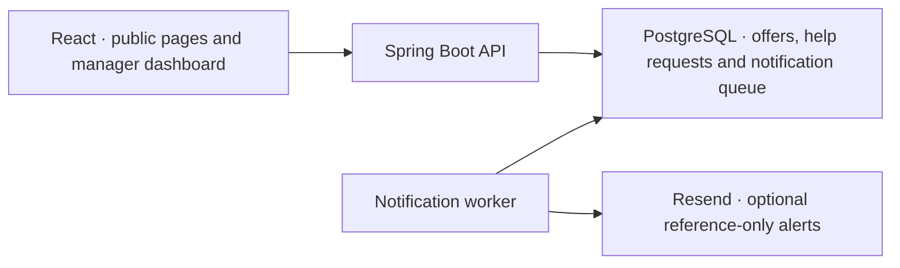

# Architecture

Riga Student Hub is a React and Vite frontend with a Java 21 Spring Boot backend. PostgreSQL stores the live service data. The hosted sample preview uses bundled examples and disables submissions.

## Public pages and requests

The React frontend obtains published offers from the API in live mode. The help form requires consent and sends a submission ID. Spring validates the fields, creates a help request and a notification job in one transaction, and returns a reference. Retrying the same submission ID returns the existing result.

## Manager and notifications

Spring Security protects management operations with a session cookie, CSRF checks and a configured BCrypt password hash. Managers can maintain offers, inspect help requests and retry failed alerts. The background worker uses the database queue to send alerts through Resend. Alerts contain the request reference. The backend applies a 90-day retention rule to help requests while the service runs.

## Deployment

Docker builds the frontend and backend into a service that serves the app and API together. Docker Compose adds a local PostgreSQL instance. Flyway manages the database schema. The sample build can be hosted independently. A live setup supplies its own database configuration, manager password hash and public contact address. Resend is optional.
